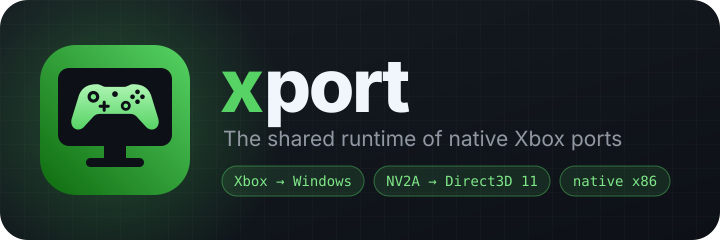

<p align="center"></p>

# xport

The shared runtime of SickSartori's native Xbox ports: everything needed to run an original Xbox game's x86 code on
Windows that **does not depend on the game**. It is used by
[mc3port](https://github.com/SickSartori/mc3port) (Midnight Club 3: DUB Edition Remix) and
[sm2port](https://github.com/SickSartori/sm2port) (Spider-Man 2).

It contains no game code or data. Each port reads everything it needs from the player's own disc image while it runs.

Version: **0.2.0**. Licence: [MIT](LICENSE).

## Why it exists

sm2port started as a copy of mc3port's runtime. The two copies drifted apart, and every fix had to be made twice (or
was forgotten in one of them). Here the shared code lives once: a fix in the library reaches every game when it
updates the submodule.

## How a port works, in short

1. The game starts from an Xbox disc image: the library reads the disc (XDVDFS, also split images and CCI) and the XBE.
2. The game's x86 code is loaded at its original address (`0x10000`) and runs as it is, in 32 bits.
3. Calls to the Xbox kernel land in our own functions (HLE): memory, threads, files, clocks, crypto.
4. The game's Direct3D library is left alone: it writes to the registers of the NV2A GPU, which the runtime emulates
   and translates to Direct3D 11.
5. Audio and input go through patches in the game (DirectSound and XInput), which for now live in each port.

## What's inside

| Folder | Contents |
|---|---|
| `src/core` | Disc images (XDVDFS, split, CCI), XBE reading, the kernel export table. No Windows headers (`xportcore`). |
| `src/pc` | The Windows runtime, see below. |
| `tests` | The library's tests and the helpers (`test.h`, `disc_builder.h`) that the games' tests use too. |
| `docs` | The logo. |
| `xport.cmake` | The file a port includes to build the library. |

`src/pc`, by topic:

| Topic | Files |
|---|---|
| Xbox kernel | `kernel.cpp`, `kernel_memory.cpp`, `kernel_dispatcher.cpp`, `kernel_system.cpp`, `kernel_crypto.cpp`, `handles.cpp`, `xbox_thread.cpp` |
| Memory and CPU | `physical_memory.cpp`, `exec_memory.cpp`, `mmio.cpp`, `privileged.cpp`, `fs_patch.cpp` |
| NV2A GPU | `nv2a_texture.cpp`, `nv2a_vsh.cpp` (vertex programs), `nv2a_combiner.cpp` (register combiners), `texture_upscale.cpp`, `texture_page_hash.h` |
| Renderer | `renderer_d3d11.cpp`: Direct3D 11, Present on its own thread and device (overlays such as RTSS don't break the textures), modern effects, debug dumps |
| Time | `game_pause.cpp`: pause, and clocks that start with the game rather than with Windows |
| Input | `gamepad.cpp`: Xbox, PlayStation, Switch and other controllers through SDL3 |
| Services | `paths.cpp` (data folder), `log.cpp`, `crash_report.cpp`, `profile.cpp`, `launcher_music.cpp`, `update_check.h`, `settings.h` |

## What stays in each port

- the game's patches (`hle_patches`) and the address tables for input and audio (`input_hle`, `dsound_hle`);
- the audio mixer (`audio_mixer.cpp`), the GPU front end (`nv2a.cpp`, `nv2a_kelvin.cpp`), `kernel_io.cpp`,
  `kernel_threads.cpp`, `runtime.cpp`, `settings.cpp`: nearly the same in both games, they will move into the library
  one at a time;
- its own part of the renderer (`renderer_game.cpp`);
- the accepted discs (`game_disc`), the launcher, the pictures, the texts.

## Using it in a port

The library is a submodule in `external/xport`, with a relative URL: on GitHub the port and the library must
belong to the same user.

```
git submodule add ../xport.git external/xport
```

In the port's `CMakeLists.txt`:

```cmake
include(external/xport/xport.cmake)
add_library(mc3runtime SHARED ${XPORT_RUNTIME_SOURCES} src/pc/...)
target_link_libraries(mc3runtime PRIVATE xportcore ...)
target_include_directories(mc3runtime PRIVATE res)          # launcher_resources.h
xport_identity(mc3runtime mc3port MC3PORT MC3_)
xport_add_tests(mc3port MC3PORT MC3_)
```

- `xportcore`: a static library with `src/core`.
- `XPORT_RUNTIME_SOURCES`: the sources of `src/pc`. They are compiled **into the game's DLL**, not on their own: the
  library and the game call each other (`kernel_internal.h`, `nv2a.h`, `audio_mixer.h` are partly implemented by the
  game), so they need the same options and link-time optimisation across all of it.
- `xport_identity(target name NAME PREFIX_)`: gives the library the game's name (`src/pc/port.h`). `XPORT_NAME` gives
  the data folder and the names of the log, settings and crash files; `XPORT_ENV_PREFIX` gives the prefix of the
  environment variables.
- `xport_add_tests(...)`: adds the library's tests to the game's `ctest`.
- `XPORT_DATA_WITH_RECOMPLAUNCHER` (optional define): keeps the data next to the exe when the game is started from
  RecompLauncher. sm2port uses it. **mc3port never does**: its players already have their data in Documents.

### Renderer hooks

Each game defines these functions in its `src/pc/renderer_game.cpp`, empty if it adds nothing (sm2port leaves them all
empty). The signatures are in `src/pc/renderer_d3d11.h`.

| Function | When | In mc3port |
|---|---|---|
| `renderer_game_narrowing` | every flat draw or clear | narrows the HUD in 16:9 |
| `renderer_game_clear` | every clear of some channels | widens the radar's clear |
| `renderer_game_enlarge` | every texture | enlarges the car liveries |
| `renderer_game_texture` | a decoded texture | draws LB and RB on the button symbols |
| `renderer_game_draw` | every draw | tunes the motion blur (`motion_blur`) |
| `renderer_game_frame_shown` | every frame shown | updates the HUD |

### Environment variables

In the code they are written as `XPORT_ENV("PROFILE")`, which becomes `MC3_PROFILE` in mc3port and `SM2_PROFILE` in
sm2port. The library's own:

| Use | Names (after the prefix) |
|---|---|
| Unattended runs | `NO_DIALOG`, `DUMP_FRAMES`, `DUMP_SECONDS`, `RESTART_FROM` |
| Measurements and traces | `PROFILE`, `WATCHDOG`, `TRACE_KERNEL`, `TRACE_WAITS` |
| Graphics debugging | `DUMP_2D`, `DUMP_TARGET`, `DUMP_TEXTURE`, `DUMP_WINDOW`, `TEX_LOG`, `TEX_LODBIAS`, `TEX_MAXLOD`, `ALWAYS_HASH`, `AO_VIEW`, `FLIP_WINDING`, `NO_POLY_OFFSET`, `TEST_PRESENT_HOOK` |
| System | `GPU_PREFERENCE`, `LANGUAGE`, `MOVE_OLD_DATA` |

Every setting in the game's `.ini` file can also be forced with `<PREFIX><KEY>` (`settings.h`).

## Building and testing

The library doesn't build on its own: it is built from a port.

```
git clone --recurse-submodules https://github.com/SickSartori/mc3port
cmake --preset pc-x86
cmake --build --preset pc-x86-release
ctest --test-dir build/pc-x86 -C RelWithDebInfo
```

Run `ctest` from PowerShell. Linking the DLL fails while the game is running.

The library's tests: `test_core` (discs, XBE), `test_log`, `test_texture_pages`, `test_textures`,
`test_update_check`, `test_data_folder`, `test_crash_report`.

## Working on it

1. Change the library inside `external/xport` of one of the ports (it is an ordinary git repository).
2. Build and test **both** games if the change touches code they both use.
3. Commit and push here, on `main`.
4. In each port: `git add external/xport` and commit the new pointer.

- Commit titles: `<version> · Area: Sentence`, as in the ports.
- A fix that is good for every game goes here, not in the port; what belongs to one game goes through a hook.
- No code from other ports or third parties without their licence.

## Supporting the project

xport and the ports built on it are free and always will be. If they are useful to you and you want to say thanks, you
can support their author on [GitHub Sponsors](https://github.com/sponsors/SickSartori) or
[Ko-fi](https://ko-fi.com/sicksartori).

## Licence

[MIT](LICENSE). The games themselves, and everything the ports read from the player's disc, belong to their owners.
